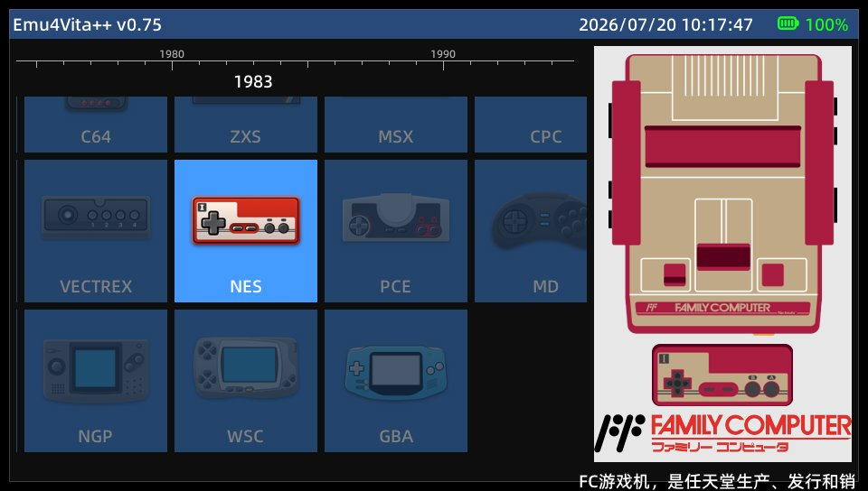
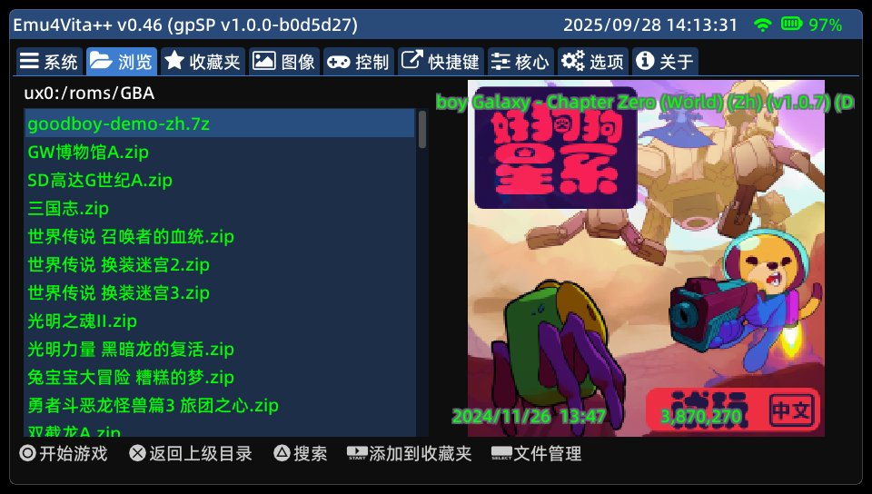
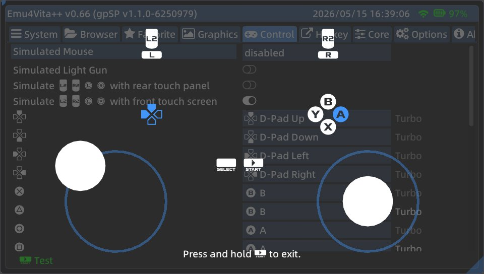
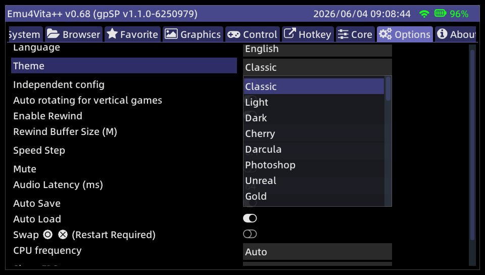
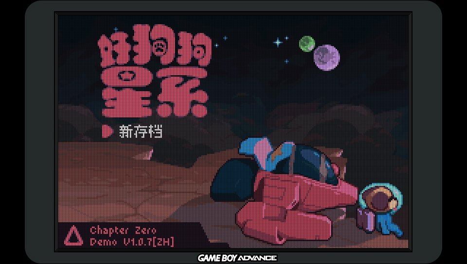
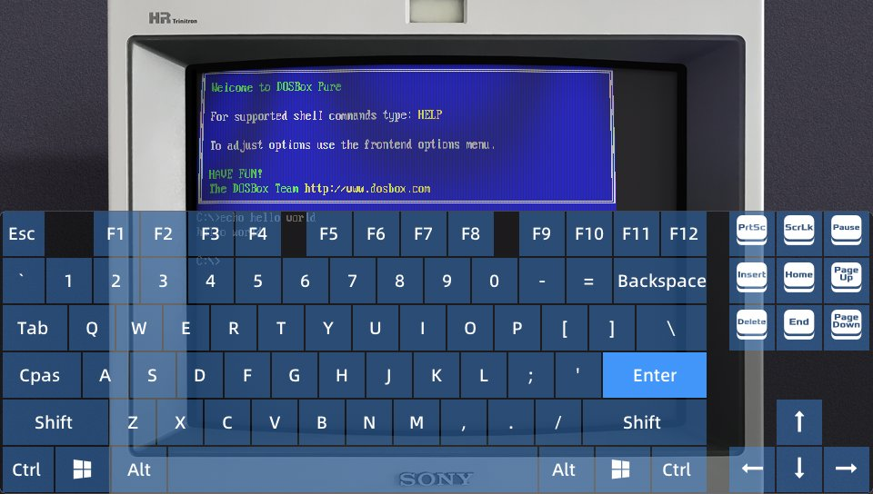
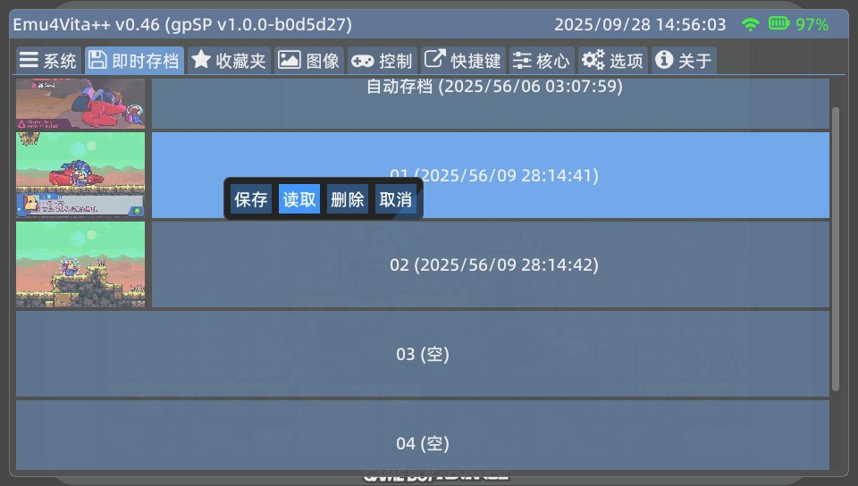
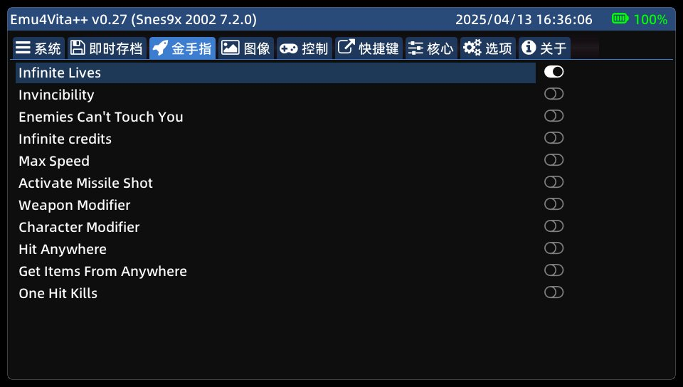
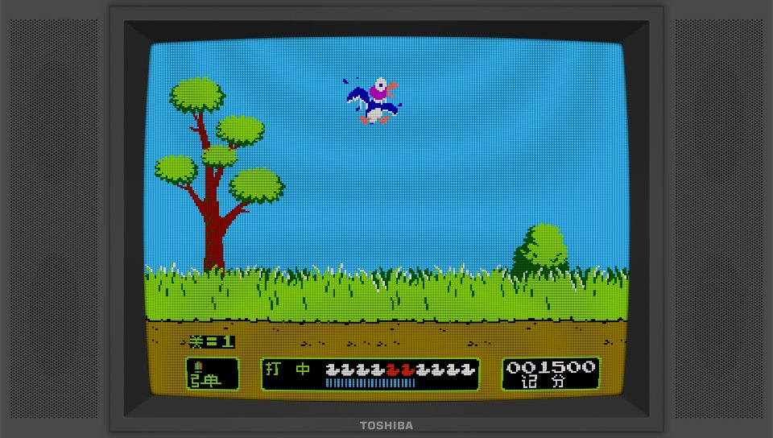

# Emu4Vita++

A frontend for emulators running on the PlayStation Vita, based on the [Libretro API](https://github.com/libretro/libretro-common).

* [Download](#download)
* [Features](#features)
* [Supported Cores](#supported-cores)
* [Building](#prerequisites)
* [Scripts](#scripts)
* [Paths](#paths)
* [Troubleshooting](#troubleshooting)
* [Credits](#credits)

## Download
[Release](https://github.com/noword/Emu4VitaPlus/releases)

[Baidu Netdisk](https://pan.baidu.com/s/1chcOOw9G1GBtlkM9K4MtRg?pwd=E4VP)

The version with logs outputs more logs to `ux0:data/EMU4VITAPLUS/[core]/Emu4Vita++.log`, but it affects performance.

## Features
### Core Selection


|                                                                                                             |                                 |
|-------------------------------------------------------------------------------------------------------------|---------------------------------|
|                                                                 | Toggle console icon             |
|                                                           | Scroll control description text |
|  or  | Launch core                     |

### ROM Browser


|                                                                                                             |                                    |
|-------------------------------------------------------------------------------------------------------------|------------------------------------|
|                                                                 | Add/remove from favorites          |
|                                                                | Open file management menu          |
|  or  | Enter directory / Go back / Launch |
|                                                       | Search                             |
|                                                         | Next search match                  |

### Controller Test



### Themes


### Game


|                                                                                                        |                   |
|--------------------------------------------------------------------------------------------------------|-------------------|
|  +  | Rewind            |
|  +           | Fast forward      |
|  +           | Slow motion       |
|                                                      | Return to menu    |

### Keyboard for PC OS emulators (DOS, PC98, etc.)



|                                                                                                           |                     |
|-----------------------------------------------------------------------------------------------------------|---------------------|
|  +  | Toggle keyboard     |
|  +     | Move keyboard up    |
|  +     | Move keyboard down  |

### Save States


### Cheats



### Duck Hunt with Touchscreen in FCEUmm


* Controls ==> Port 2 Device, set to Zapper

### [Overlays and Shaders](GRAPHICS.md)

## Supported Cores
Arcade
  - [FinalBurn Lite](https://gitee.com/yizhigai/libretro-fba-lite)
  - [FinalBurn Alpha 2012](https://github.com/libretro/fbalpha2012)
  - [FinalBurn Neo](https://github.com/libretro/FBNeo)
  - [FinalBurn Neo Xtreme](https://github.com/KMFDManic/FBNeo-Xtreme-Amped)
  - [mame2000](https://github.com/libretro/mame2000-libretro)
  - [mame2003](https://github.com/libretro/mame2003-libretro)
  - [mame2003_plus](https://github.com/libretro/mame2003-plus-libretro)
  - [mame2003 Xtreme](https://github.com/KMFDManic/mame2003-xtreme)

NES
  - [FCEUmm](https://github.com/libretro/libretro-fceumm)
  - [Nestopia](https://github.com/libretro/nestopia)

SNES
  - [Snes9x 2005](https://github.com/libretro/snes9x2005)
  - [Snes9x](https://github.com/libretro/snes9x)
  - [Supafaust](https://github.com/Rinnegatamante/supafaust)
  - [ChimeraSNES](https://github.com/jamsilva/chimerasnes)

MD
  - [Genesis Plus GX](https://github.com/libretro/Genesis-Plus-GX)
  - [Genesis Plus GX Wide](https://github.com/libretro/Genesis-Plus-GX-Wide)
  - [PicoDrive](https://github.com/libretro/picodrive)
  
GBC
  - [Gambatte](https://github.com/libretro/gambatte-libretro)
  - [TGB Dual](https://github.com/libretro/tgbdual-libretro.git)

GBA
  - [gpSP](https://github.com/libretro/gpsp)
  - [VBA Next](https://github.com/libretro/vba-next)
  - [mGBA](https://github.com/libretro/mgba)

PCE
  - [Mednafen PCE Fast](https://github.com/libretro/beetle-pce-fast-libretro)
  - [Mednafen SuperGrafx](https://github.com/libretro/beetle-supergrafx-libretro)

PS1
  - [PCSX ReARMed](https://github.com/libretro/pcsx_rearmed)

NEOCD
  - [NeoCD](https://github.com/libretro/neocd_libretro)

WSC
  - [Mednafen Wonderswan](https://github.com/libretro/beetle-wswan-libretro)

NGP
  - [Mednafen NeoPop](https://github.com/libretro/beetle-ngp-libretro)

DOS
  - [DOS Pure](https://github.com/libretro/dosbox-pure)

Atari 2600
  - [Stella 2014](https://github.com/libretro/stella2014-libretro)

Atari 5200
  - [Atari800](https://github.com/libretro/libretro-atari800)

Atari 7800
  - [ProSystem](https://github.com/libretro/prosystem-libretro)

Vectrex
  - [vecx](https://github.com/libretro/libretro-vecx)
  
Amiga
 - [uae4arm](https://github.com/libretro/uae4arm-libretro)

ZX Spectrum
 - [fuse](https://github.com/libretro/fuse-libretro)

PC98
 - [Neko Project II](https://github.com/libretro/libretro-meowPC98)
  
MSX
 - [Marat Fayzullin's fMSX](https://github.com/libretro/fmsx-libretro)
 - [blueMSX](https://github.com/libretro/blueMSX-libretro)

Commodore 64
 - [VICE](https://github.com/libretro/vice-libretro)

Sharp X68000
 - [PX68k](https://github.com/libretro/px68k-libretro)

## Prerequisites
### Windows
* Install [msys2](https://www.msys2.org/) or [devkitPro](https://github.com/devkitPro/installer/releases)
#### Enter msys
* Install [vitasdk](https://vitasdk.org/)
* Install cmake, python, ccache
  
  ```bash
  pacman -S cmake python python-pip ccache
Install openpyxl, pillow, lz4, toml

bash
pip3 install openpyxl pillow pz4 toml
Or install suitable versions via pacman (recommended)

bash
pacman -S mingw-w64-???-???-python-openpyxl \
          mingw-w64-???-???-python-pillow \
          mingw-w64-???-???-python-lz4 \
          mingw-w64-???-???-python-toml
Linux
Follow the Windows steps. If you're on Linux, you should be able to figure it out yourself.

Building
bash
mkdir build
cd build
cmake ../
make
Build with logs:

bash
mkdir build-debug
cd build-debug
cmake ../ -DWITH_LOG=ON
make
Build standalone core vpk:

bash
mkdir build-gpsp
cd build-gpsp
cmake ../ -DBUILD=gpsp
make
Scripts
Translation


Generate shaders
bash
./compile_shaders.py  # Find psp2cgc.exe online yourself
Paths
Previews
The program automatically looks for a jpg or png image with the same name in the .previews directory under the rom directory. If not found, it searches for a screenshot from the save state.

Cheats
The program searches for a .cht file with the same name in the rom directory, the .cheats directory under the rom directory, and the ux0:/data/EMU4VITAPLUS/[core]/cheats directory, using the first one found.

Overlays
The program reads overlays.ini from ux0:/data/EMU4VITAPLUS/[core]/overlays.

Save Files
ux0:/data/EMU4VITAPLUS/[core]/savefiles/[rom]

BIOS
ux0:/data/EMU4VITAPLUS/system

Please copy the corresponding BIOS files to this directory [IMPORTANT].

RetroArch romset Compatibility
Emu4Vita++ attempts to read .lpl files from the following directories:

ux0:data/EMU4VITAPLUS/playlists

playlist_directory in ux0:data/retroarch/retroarch.cfg

ux0:data/retroarch/playlists

It uses the label and path information from the lpl to display ROM names and thumbnails.

Troubleshooting
https://github.com/noword/Emu4VitaPlus/issues

QQ Group: 550802386

If you want to report a problem, please specify the version and the core used, and the steps taken before the problem occurred;

If a problem occurs during gameplay, please upload the ROM;

If the program crashes, please find the psp2dmp file under ux0:/data/ and upload it.

Credits
一直改

KyleBing

TearCrow

SnowPin (RetroAchievements Admin)

Scott (RetroAchievements Testing)

yyoossk (Japanese translation)

theheroGAC (Italian translation)

chronoss09 (French translation)

limonetas (Spanish translation)

MayanKoyote (Russian translation)

And all the developers of the open-source projects used in this project.
